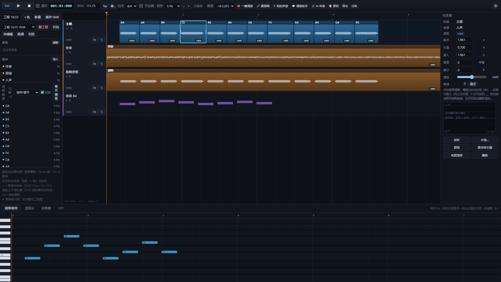
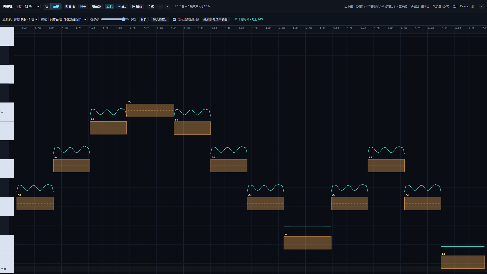
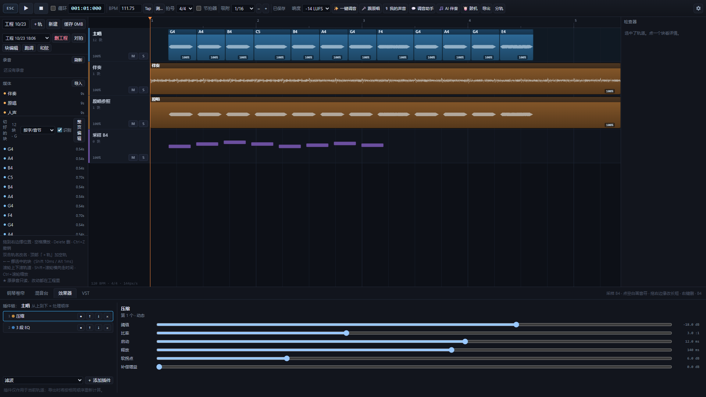
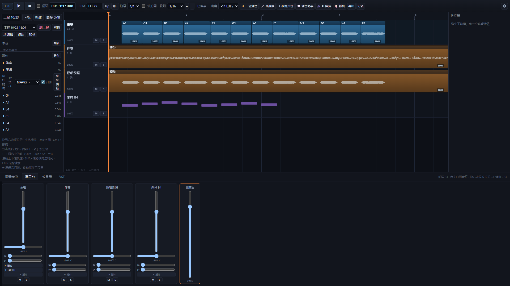
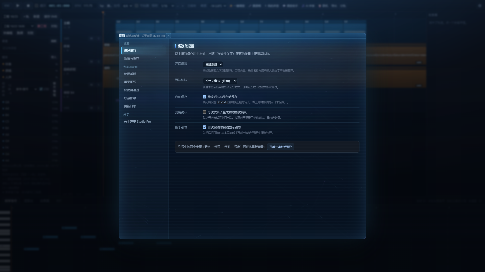

# 声麦 Studio Pro

**录音、修音、编曲、混音与导出，在本机一处完成的多轨音频工作站。**

---

## 概述

声麦 Studio Pro 是一套在本机完成的音频工作站：录音、修音、编曲、混音与导出在同一处做完。
人声进来后按字或音节切成块，逐块修改音高与长度，再叠和声、配伴奏、插入效果器链，
最后按目标响度导出成品。

软件不含账号体系，不含统计上报；录音、工程与导出文件只保存在本机。

---

## 界面

| 音高曲线 | 效果器链 |
| --- | --- |
|  |  |
| 逐块编辑音高曲线，可与原唱对比 | 每轨独立插件链，九种内置效果 |

| 混音台 | 界面语言 |
| --- | --- |
|  |  |
| 多轨混音与母带响度 | 简体中文、繁體中文、English、日本語、한국어 |

---

## 功能

### 修音与编辑

- **按字切分**：依据元音核定位每个字与音节的边界，逐块调整音高、长度或删除。
  原录音只读，改动均可撤销。
- **音高曲线**：按半音与音分微调，逐块处理，不改变原始录音。
- **一键调音**：在本机测量响度、峰值、频段与音高偏差，输出可勾选的调整方案，不自动修改工程。
- **跟原唱**：导入原唱人声作为参照，给出音高修正方案，确认后才修改。
- **个人音色补音**：用你自己录音训练的音色模型，把一段音延长或缩短（0.3×–8×）得更接近本人音色。
  模型默认在本机运行，可试听、可撤销。

### 编曲与混音

- **和声与加厚**：按音程生成和声轨，左右加厚，做成叠唱效果。
- **多轨工程**：BPM 网格、吸附与量化、变调、每轨音量与声像、混音台、逐轨插件链。
- **内置效果器**：滤波、三段 EQ、压缩、限幅、失真、合唱、镶边、颤音、位深压缩，逐轨插入。
- **VST3 插件**：离线渲染并冻结轨道，导出时按相同顺序重算。插件功能由单独的
  [插件支持包](#插件支持包)提供。
- **伴奏与鼓机**：导入伴奏，或用鼓组在钢琴卷帘里编写节奏。

### 生成与输出

- **AI 伴奏**：用文字描述风格与歌词，由第三方音乐生成平台产出伴奏或整首歌，
  生成后自动拆分为人声与伴奏两条轨。只发送文字，不发送录音。
- **调音助手**：用一句话描述听感（例如「人声太干」），由语言模型换算为具体参数改动，
  逐条列出，勾选后才应用，一次撤销可全部还原。只发送参数与这句话。
- **母带与导出**：按目标响度（LUFS）导出 WAV / MP3，可写标签与封面；
  也可把每条轨道分别导出并打包为 ZIP，供其他宿主软件做后期。
- **界面语言**：简体中文、繁體中文、English、日本語、한국어，随时切换。

---

## 运行要求

| 项 | 要求 |
| --- | --- |
| 操作系统 | Windows 10 版本 1809 及以上 / Windows 11（64 位） |
| 内存 | 4 GB 以上；处理长工程或运行音色模型建议 8 GB |
| 磁盘 | 500 MB 以上可用空间（录音与缓存另计） |
| 其他 | 麦克风；音频输出设备 |

界面使用 Windows 自带的 WebView2 运行时，无需另外安装。

---

## 安装

在 Microsoft Store 中搜索 **声麦 Studio Pro** 安装，由商店负责更新。
1.0.6 正在认证中，上架后本说明会更新为商店链接。

---

## 插件支持包

VST3 插件由单独的「插件支持包」提供，不与主程序一起分发。该支持包是一个独立程序，
按 GPL-3.0 分发，完整对应源码随包附在 `src\` 目录下。

1. 在本仓库的 [Releases](https://github.com/IMXia-Chan/SingMic-Studio/releases) 下载
   `SingMicVstHost-<版本>-win64.zip`
2. 打开 声麦 Studio Pro → **设置 → 插件支持**
3. 点「打开支持包文件夹」，把 zip 里的 `SingMicVstHost` 整个文件夹解压进去。
   最终应当是 `...\SingMic\data\vst_host\SingMicVstHost\SingMicVstHost.exe`
4. 回到程序打开插件页即可，不需要重启

未安装支持包时，主程序其余功能不受影响；插件页会明确提示缺少支持包。

---

## 定价

**免费，全部功能可用，不含内购。**

AI 伴奏与调音助手需要你在软件内自行配置相应平台与密钥，费用由你与该平台直接结算；
软件本身不含账号，也不代为充值。不配置也能正常使用其余全部功能。

---

## 隐私

录音、工程与导出文件只保存在本机，软件不含账号与统计上报。
个人音色补音的模型默认在本机运行。

完整说明见隐私政策：

- 中文：https://imxia-chan.github.io/SingMic-Studio/
- English：https://imxia-chan.github.io/SingMic-Studio/en.html

---

## 常见问题

**需要联网吗？**
除了你主动使用的 AI 伴奏、调音助手与模型下载，其余功能完全离线可用。

**录音会上传吗？**
不会。录音、工程与导出文件只在本机，软件不向任何服务器发送音频；
AI 伴奏只发送文字，调音助手只发送那一句话与参数。

**为什么不把 VST3 插件直接做进来？**
插件能力依赖的组件按 GPL-3.0 分发。为保持主程序可以按自己的许可发布，
插件部分被拆成独立程序单独分发。

**支持哪些界面语言？**
简体中文、繁體中文、English、日本語、한국어。

---

## 反馈

- 问题与建议：[Issues](https://github.com/IMXia-Chan/SingMic-Studio/issues)
- 支持邮箱：singmic.studio@foxmail.com

---

## 授权

本仓库不含程序源码，仅包含本说明与隐私政策页面。

- **主程序**：专有软件，保留所有权利。
- **插件支持包**：按 [GPL-3.0](https://www.gnu.org/licenses/gpl-3.0.html) 分发。

© 2026 IMXia-Chan
